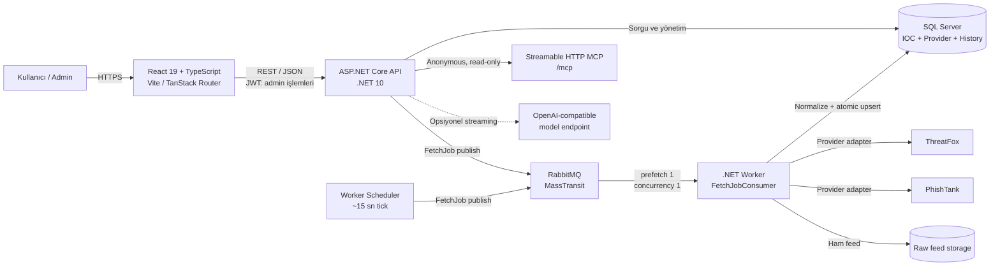
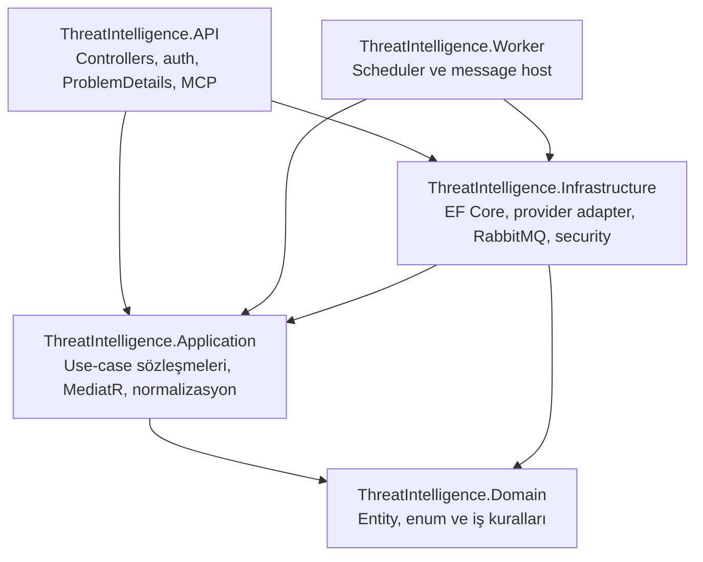
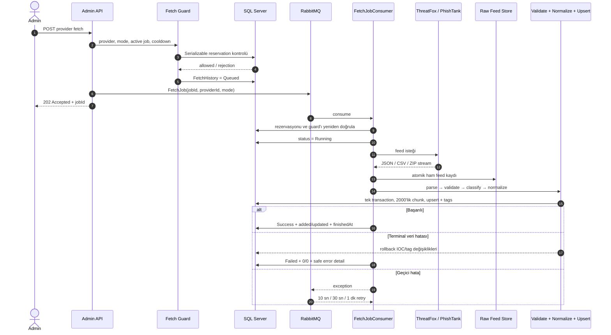
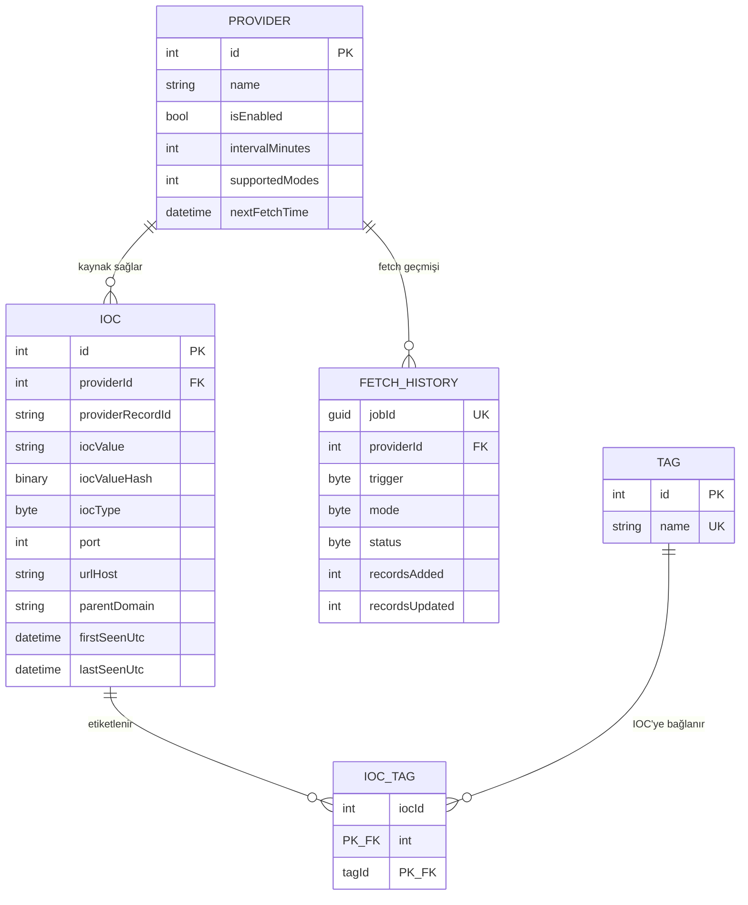

# Tehdit İstihbaratı Toplama Platformu — Teknik Sunum İçeriği

> Hedef kitle: ekip lideri ve teknik ekip  
> Bağlam: staj kapsamında verilen teknik görevin çözümü  
> Önerilen anlatım süresi: 20–25 dakika + soru-cevap  
> Sunum yaklaşımı: gereksinim → teknik karar → uygulama kanıtı → sonuç

## Proje Tanımı ve Kapsamı

Bu proje, staj kapsamında verilen teknik görev doğrultusunda geliştirilmiştir.

Görev; açık siber tehdit istihbaratı kaynaklarından IP adresi, domain ve URL gibi IOC’leri (Indicator of Compromise) toplayan, farklı kaynaklardan gelen verileri ortak bir yapıda işleyen, tekrar eden kayıtları kontrol eden ve kullanıcıların bu verileri web arayüzü üzerinden araştırabilmesini sağlayan bağımsız bir uygulama geliştirmektir.

Projenin amacı, farklı formatlarda yayımlanan açık tehdit istihbaratı verilerini tek bir sistemde birleştirerek araştırılabilir ve kaynak bilgisi korunmuş bir IOC veri kümesi oluşturmaktır.

Uygulama; kurum içi sistemlere, kurum verilerine veya mevcut bir kurum koduna bağımlı değildir. Veri toplama yalnızca açık/public kaynaklar üzerinden yapılır. Sistem bir engelleme veya otomatik müdahale ürünü değil; IOC toplama, normalizasyon, kaynak ilişkilendirme, arama ve teknik inceleme platformudur.

### Kapsam

Proje kapsamında aşağıdaki yetenekler sağlanmıştır:

- ThreatFox ve PhishTank olmak üzere iki açık tehdit istihbaratı kaynağından veri alınması
- IPv4, IPv6, domain ve URL türündeki IOC’lerin sınıflandırılması ve ortak biçime dönüştürülmesi
- Farklı sağlayıcı formatlarının ortak `IoC` modelinde saklanması
- Aynı sağlayıcı kaydının tekrar geldiğinde yeni kopya yerine güncellenmesi
- Aynı IOC’nin farklı sağlayıcılardaki kayıtlarının kaynak bilgisi kaybolmadan gruplanması
- Browse, tekil arama, çoklu arama, öneri, detay ve ilişki görüntüleme yetenekleri
- Sağlayıcıların manuel veya zamanlanmış biçimde yeniden senkronize edilmesi
- Dış kaynak, mesajlaşma ve doğrulama hatalarının kontrollü yönetilmesi
- Yönetim ekranlarından sağlayıcı, fetch geçmişi, log, özet ve çalışma ayarlarının izlenmesi
- Otomatik backend, frontend ve uçtan uca test altyapısı
- Docker Compose ve README üzerinden tekrarlanabilir yerel çalışma ortamı

### Kapsam dışı veya ikincil konular

- IOC’lerin firewall, SIEM veya EDR sistemlerine otomatik uygulanması
- Kurum içi veri kaynaklarıyla entegrasyon
- Tam kapsamlı kullanıcı yaşam döngüsü; self-service kayıt ve refresh token akışı
- Yatay ölçekli dağıtık çalışma; mevcut MVP tek Worker tüketicisiyle kontrollü çalışır
- AI raporu, IOC Chat ve public MCP çekirdek gereksinimlerin parçası değildir; tamamlayıcı/ileri yeteneklerdir

---

## Gereksinimler ve Uygulamadaki Karşılıkları

Projede sekiz zorunlu gereksinim bulunmaktadır. Her gereksinimin uygulamadaki karşılığı aşağıda gereksinim izlenebilirliği korunarak açıklanmıştır.

### REQ-01 — Birden fazla açık tehdit kaynağı entegrasyonu

**Gereksinim:**  
En az iki farklı açık/public veri kaynağı sisteme entegre edilmelidir.

**Uygulama:**  
Sisteme ThreatFox ve PhishTank sağlayıcıları entegre edilmiştir. Her sağlayıcının veri biçimi ve erişim modeli farklı olduğu için sağlayıcıya özel client, parser, validator ve mapper bileşenleri kullanılmıştır.

- ThreatFox için recent ve full fetch akışları desteklenir.
- PhishTank için full veri seti akışı desteklenir.
- İndirilen ham beslemeler parse işleminden önce `RawFeedStore` üzerinden dosya sistemine atomik biçimde kaydedilir.
- Sağlayıcıdan gelen kayıtlar ortak `NormalizedProviderRecord` sözleşmesine dönüştürülür.
- Sağlayıcıya özel alanlar ortak `IoC` alanlarına ve gerektiğinde tipli metadata alanlarına eşlenir.

**Teknik karar:**  
Yeni bir açık kaynak eklemek, çekirdek sorgu veya domain kurallarını değiştirmek yerine yeni bir adapter/executor ailesi eklemeyi gerektirir. Buna karşılık yeni bir `providers` satırı tek başına yeterli değildir; çalışan bir entegrasyon için kod tarafında client, parser, doğrulayıcı, mapper ve executor kaydı da gerekir.

**Kod kanıtı:** `ThreatFoxFetchExecutor`, `PhishTankFetchExecutor`, provider mapper/validator sınıfları ve `ProviderFetchExecutorRouter`.

---

### REQ-02 — IOC türlerinin desteklenmesi ve aranması

**Gereksinim:**  
Sistem IPv4, domain ve URL türlerini desteklemeli; bu değerler üzerinden arama yapılabilmelidir.

**Uygulama:**  
Sistem IPv4, IPv6, domain ve URL türlerini desteklemektedir. IPv6 desteği zorunlu gereksinimin üzerinde ek bir yetenektir.

IOC sisteme alınırken `IocClassifier` ile türü belirlenir ve türe özel normalizer uygulanır:

- IPv4 değerleri katı biçimde doğrulanır; belirsiz/leading-zero biçimler reddedilir.
- IPv6 değerleri sıkıştırılmış canonical gösterime dönüştürülür.
- Domain değerleri küçük harfe çevrilir, tek trailing dot kaldırılır ve Public Suffix List ile `parentDomain` hesaplanır.
- URL’lerde scheme ve DNS host normalize edilir, fragment kaldırılır, varsayılan portlar IOC değerinden çıkarılır; path ve query anlamı korunur.
- IP ve URL’lerde açık port varsa ayrı `port` alanında saklanır.

Kullanıcılar;

- serbest IOC değeriyle kesin arama,
- birden fazla IOC için toplu arama,
- IOC prefix önerileri,
- browse ekranı,
- tür, sağlayıcı, etiket, malware, hedef ve tarih filtreleri

üzerinden veri kümesini araştırabilir.

**Teknik karar:**  
Aynı normalizasyon kuralları hem ingestion hem kullanıcı sorgu girdisinde uygulanır. Böylece yazma ve okuma tarafındaki IOC kimliği birbirinden sapmaz.

**Kod kanıtı:** `IocType`, `IocClassifier`, `Ipv4Normalizer`, `Ipv6Normalizer`, `DomainNormalizer`, `UrlNormalizer`, `SearchIocs`, `BulkSearchIocs` ve `IocsController`.

---

### REQ-03 — Ortak veri modeli ve tekrar kayıtların önlenmesi

**Gereksinim:**  
Gelen veriler ortak bir modele dönüştürülmeli ve aynı gösterge tekrar geldiğinde gereksiz kopya kayıt oluşmamalıdır.

**Uygulama:**  
Farklı kaynaklardan gelen kayıtlar ortak `IoC` modeli üzerinden saklanır. Tekilleştirme iki ayrı kimlik kuralıyla yapılır:

1. **Sağlayıcı kayıt kimliği:** `(providerId, providerRecordId)`  
   Aynı sağlayıcının aynı kaydı yeniden geldiğinde kayıt eklenmez; mevcut satır upsert ile güncellenir.
2. **Sağlayıcı içi IOC endpoint kimliği:** `(providerId, iocType, iocValueHash, port)`  
   Aynı sağlayıcı içinde aynı normalize IOC/port kombinasyonunun ikinci kez fiziksel satır oluşturması veritabanı unique index’iyle engellenir.

`iocValueHash`, uzun IOC değerlerinin indexlenebilir sabit boyutlu kimliği olarak SHA-256 ile hesaplanır. Hash eşleşmesi tek başına yeterli kabul edilmez; olası hash çakışmasına karşı gerçek `iocValue` değeri de karşılaştırılır.

Farklı sağlayıcılarda görülen aynı IOC fiziksel olarak ayrı kaynak satırları hâlinde korunur. API okuma sırasında `(iocType, normalized iocValue)` kimliğine göre mantıksal grup üretir ve tüm kaynak satırlarını `sources` altında döndürür.

**Sunumda özellikle vurgulanmalı:**  
Sistem “farklı kaynaktaki aynı IOC’yi silerek tek satıra düşürmez.” Çünkü kaynak/provenance bilgisi güvenlik araştırması için değerlidir. Tekilleştirme sağlayıcı satırı seviyesinde, gruplama ise sorgu seviyesinde yapılır.

**Kod kanıtı:** `IoC`, `IocBatchWriter`, `IoCConfiguration`, `Sha256ValueHasher`, `IocRepository` ve `IocQueryReader.BuildGroupsAsync`.

---

### REQ-04 — Kaynak bilgisinin saklanması ve gösterilmesi

**Gereksinim:**  
Her göstergenin hangi kaynaktan veya kaynaklardan geldiği saklanmalı ve kullanıcı tarafından görülebilmelidir.

**Uygulama:**  
Her IOC satırı bir `Provider` ile ilişkilidir. Aşağıdaki kaynak bilgileri korunur:

- sağlayıcı adı ve sağlayıcı kayıt kimliği,
- sağlayıcı detay bağlantısı,
- kaynağa ait ilk/son görülme zamanları,
- etiketler,
- ThreatFox alanları: threat type, malware, alias, confidence, compromised bilgisi,
- PhishTank alanları: verified, online, target ve bounded JSON metadata.

Arama ve browse sonuçlarında aynı IOC bir grup olarak gösterilir. Detay ekranında her provider satırı ayrı bir kaynak kartı olarak listelenir. Böylece kullanıcı IOC’nin yalnızca değerini değil; hangi sağlayıcının hangi metadata ile raporladığını da görür.

**Teknik karar:**  
Etiketler grup seviyesinde eritilmez; hangi kaynaktan geldikleri korunarak ilgili source altında gösterilir.

**Kod kanıtı:** `Provider`, `IoC`, `Tag`, `IoCTag`, `IocQueryReader.MapSource` ve `IocSourceCard`.

---

### REQ-05 — IOC arama ve detay görüntüleme

**Gereksinim:**  
Kullanıcı bir göstergeyi arayabilmeli ve ilgili temel detayları görüntüleyebilmelidir.

**Uygulama:**  
Web arayüzünde aşağıdaki araştırma akışları bulunmaktadır:

- ana sayfada hızlı IOC araması ve özet görünümü,
- tekil ve çoklu IOC arama ekranı,
- server-side pagination/sorting destekli browse tablosu,
- IOC detay ekranı,
- `urlHost` ve `parentDomain` üzerinden ilişki sorguları,
- provider/tag autocomplete ve IOC önerileri.

IOC detayında normalize değer ve tür, aggregate ilk/son görülme zamanları, kaynak kayıtları, kaynak bazlı metadata/etiketler, false-positive değerlendirmesi ve URL/domain ilişkileri gösterilir.

API yüzeyinin temel bölümü şöyledir:

| Endpoint | Amaç |
| --- | --- |
| `GET /api/iocs` | Filtreli, sıralı ve sayfalı browse |
| `GET /api/iocs/search` | Normalize edilmiş kesin arama |
| `POST /api/iocs/search/bulk` | Sıralı çoklu IOC sorgusu |
| `GET /api/iocs/suggestions` | Prefix tabanlı bounded öneri |
| `GET /api/iocs/{id}` | Kaynak-atıflı IOC detayı |
| `GET /api/iocs/{id}/relations` | Host veya parent-domain ilişkileri |

**Teknik karar:**  
Frontend başarılı API cevaplarını Zod şemalarıyla doğrular; hata cevapları RFC 9457 uyumlu Problem Details sözleşmesi ve correlation ID ile taşınır.

**Kod kanıtı:** `IocsController`, `IocQueryReader`, `apiClient.ts`, `schemas.ts`, `search.tsx`, `browse.tsx` ve `iocs.$id.tsx`.

---

### REQ-06 — Veri kaynaklarının yeniden senkronizasyonu

**Gereksinim:**  
Veri kaynakları tekrar senkronize edilebilmeli veya güncellenebilmelidir. Bunun manuel veya otomatik olması geliştiricinin tercihidir.

**Uygulama:**  
Sistem hem manuel hem otomatik fetch destekler.

- Admin, sağlayıcının varsayılan modu veya full modu için fetch başlatabilir.
- API işlemi doğrudan çalıştırmaz; guard kontrolü ve `Queued` history rezervasyonundan sonra `FetchJob` mesajını RabbitMQ’ya yayınlar.
- Başarılı tetikleme `202 Accepted` ve bir `jobId` döndürür.
- Worker mesajı tüketir ve sağlayıcı executor’ını çalıştırır.
- Worker içindeki scheduler yaklaşık 15 saniyede bir zamanı gelen sağlayıcıları kontrol eder.
- Yeni seed edilmiş sağlayıcı, ilk başarılı manuel fetch tamamlanana kadar otomatik planlamaya başlamaz.
- Admin arayüzü fetch geçmişini, durumu, eklenen/güncellenen kayıt sayılarını ve hata sonucunu gösterir.

**Teknik karar:**  
Uzun ve hataya açık dış kaynak çağrıları API request süresinden ayrılmıştır. Queue + Worker yapısı kullanıcı isteğini hızlı bitirir, ingestion hatasını HTTP arayüzünden izole eder ve retry politikasını tek yerde tutar.

**Kod kanıtı:** `AdminProviderFetchController`, `FetchGuard`, `MassTransitFetchJobPublisher`, `FetchJobConsumer`, `FetchScheduler` ve `FetchSchedulerService`.

---

### REQ-07 — Dış kaynak hatalarının kontrollü yönetimi

**Gereksinim:**  
Bir dış kaynak hata verdiğinde mevcut başarılı veriler bozulmamalı; hata kontrollü biçimde ele alınmalıdır.

**Uygulama:**  
Her fetch bir `FetchHistory` kaydıyla `Queued → Running → Success/Failed` durum makinesi üzerinden izlenir.

- Provider bulunamadıysa `404`, mod desteklenmiyorsa `400`, guard aktifse `409`, mesaj broker’a gönderilemiyorsa `503` döner.
- Guard; devre dışı sağlayıcıyı, desteklenmeyen modu, aktif fetch’i ve cooldown ihlalini engeller.
- Worker tüketim anında rezervasyonu ve guard koşullarını yeniden kontrol eder; eski/tekrarlı mesajlar çalıştırılmaz.
- Timeout, 5xx ve geçici altyapı hataları job seviyesinde 10 sn, 30 sn ve 1 dk aralıklarla tekrar denenir.
- Doğrulama/parse gibi terminal hatalar retry edilmez.
- Bir fetch içindeki IOC ve tag yazımları tek dış transaction içinde, yaklaşık 2.000 kayıtlık bounded chunk’larla yürütülür.
- Geçersiz kayıt veya kimlik çakışması bütün IOC/tag transaction’ını rollback eder.
- Başarısız fetch, daha önce başarıyla yazılmış mevcut IOC verisini silmez.
- Hata durumunda history ayrı olarak `Failed`, sayaçlar `0/0` ve güvenli hata özetiyle kaydedilir.

**Teknik karar:**  
Atomiklik “kısmi başarı” yerine veri tutarlılığını önceliklendirir. Büyük veri setlerinde chunk kullanılsa da tüm chunk’lar aynı outer transaction’ın parçasıdır.

**Kod kanıtı:** `FetchLifecycle`, `FetchHistory`, `FetchErrorClassifier`, `FetchRetryPolicy`, `IocBatchWriter` ve `UnitOfWork` testleri.

---

### REQ-08 — Otomatik testler ve yerel çalıştırılabilirlik

**Gereksinim:**  
Temel iş kuralları için otomatik testler bulunmalı ve proje README üzerinden yerel ortamda çalıştırılabilir şekilde açıklanmalıdır.

**Uygulama:**  
Backend için xUnit tabanlı unit ve SQL Server/RabbitMQ destekli integration testleri bulunur. Test alanları şunları kapsar:

- IOC sınıflandırma ve normalizasyon kuralları,
- sağlayıcı doğrulama, parser ve mapper davranışları,
- upsert, duplicate kontrolü, hash çakışması savunması ve constraint’ler,
- transaction rollback ve fetch history state machine,
- guard, scheduler, queue, retry ve lifecycle event’leri,
- authentication, authorization ve API sözleşmeleri,
- şifreleme, secret store, log redaction ve AI güvenlik sınırları,
- IOC sorguları, ilişkiler, gruplama ve filtreler.

Frontend tarafında Jest + React Testing Library ile şema, store, route guard, API client ve kullanıcı arayüzü testleri; Playwright ile smoke/static-runtime E2E testleri bulunmaktadır.

README; .NET, Node.js ve Docker gereksinimlerini, `.env` yapılandırmasını, SQL Server/RabbitMQ başlatmayı, API/Worker/frontend komutlarını, test komutlarını, health endpoint’lerini ve Scalar dokümantasyonunu açıklar.

**Kod kanıtı:** `tests/ThreatIntelligence.UnitTests`, `tests/ThreatIntelligence.IntegrationTests`, `frontend/src/**/*.test.*`, `frontend/e2e`, `README.md` ve `docker-compose.yml`.

---

## Genel Mimari

Sistem; kullanıcı arayüzü, senkron HTTP API, asenkron ingestion Worker’ı, mesaj broker’ı ve ilişkisel veritabanı olmak üzere ayrıştırılmış bileşenlerden oluşur.



### Bileşen sorumlulukları

| Bileşen          | Sorumluluk                                                                                      |
| ---------------- | ----------------------------------------------------------------------------------------------- |
| Frontend         | Arama, browse, detay, ilişkiler, admin işlemleri ve durum sunumu                                |
| API              | HTTP , auth, sorgu orchestration, yönetim, fetch rezervasyonu ve mesaj yayınlama                |
| Worker           | Scheduler, mesaj tüketimi, dış provider erişimi, parse/validation/normalization ve kalıcı yazım |
| RabbitMQ         | API/scheduler ile Worker arasındaki dayanıklı iş kuyruğu ve job-level retry                     |
| SQL Server       | IOC kaynak satırları, provider, tag, history, kullanıcı, ayar ve şifreli secret verisi          |
| Raw feed storage | İndirilen provider çıktısının parse öncesi atomik dosya kopyası                                 |
| Public MCP       | REST sorgu semantiğini kullanan anonim, read-only araç yüzeyi                                   |

### Neden API ve Worker ayrı?

- Dış kaynakların gecikmesi ve hata oranı kullanıcı HTTP isteğini bloklamaz.
- Fetch retry ve concurrency politikası tek ingestion sürecinde yönetilir.
- API query yüküyle provider ingestion yükü birbirinden ayrılır.
- Fetch işi `jobId` ve history kaydıyla uçtan uca izlenebilir.

---

## Backend Katmanları

Backend, Clean Architecture yaklaşımına yakın dört ana katman ve iki host uygulamasıyla düzenlenmiştir.



### Katmanların rolü

- **Domain:** `IoC`, `Provider`, `FetchHistory`, `Tag`, `User` gibi entity’ler; geçerli state transition ve temel invariants.
- **Application:** IOC query/use-case’leri, normalizer/classifier bileşenleri, provider record sözleşmeleri, fetch sözleşmeleri ve abstraction’lar.
- **Infrastructure:** EF Core repository/query reader, SQL Server mapping/migration, RabbitMQ/MassTransit, provider client/parser/executor’ları, JWT/BCrypt, AES-GCM secret store, Serilog, health check ve AI adapter’ları.
- **API:** Controller’lar, RFC 9457 hata sözleşmesi, JWT middleware, role policy, OpenAPI/Scalar, public MCP ve HTTP rate-limit sınırları.
- **Worker:** Aynı application/infrastructure servislerini kullanarak fetch consumer ve scheduler’ı host eder.

### Bağımlılık yönünün faydası

- Domain kuralları HTTP, SQL Server veya provider formatına bağlı değildir.
- Sağlayıcı entegrasyonları adapter olarak değiştirilebilir.
- Normalizasyon ve use-case’ler birim testleriyle izole doğrulanabilir.
- API ile Worker aynı kuralları ve altyapı sözleşmelerini paylaşır, fakat farklı runtime sorumluluklarına sahiptir.

### CQRS kullanımı

MediatR özellikle IOC query use-case’lerinde controller ile uygulama davranışı arasındaki koordinasyonu sağlar. Sistem tam anlamıyla ayrı read/write veri tabanları kullanmaz; CQRS burada sorumluluk ayrımı ve test edilebilir handler tasarımı seviyesindedir.

---

## Fetch – Ingestion Akışı



### Akışın önemli ayrıntıları

1. **Rezervasyon:** Trigger anında `FetchHistory` satırı oluşturulur; aynı provider için paralel fetch engellenir.
2. **İkinci guard:** Mesaj tüketildiğinde koşullar tekrar değerlendirilir. Böylece stale veya duplicate mesaj güvenli biçimde atlanır.
3. **Provider routing:** `ProviderFetchExecutorRouter`, provider kimliğine göre ThreatFox veya PhishTank executor’ını seçer.
4. **Ham veri:** Provider cevabı parse edilmeden önce benzersiz zaman damgalı dosyaya yazılır; `.tmp` dosya rename edilerek kısmi dosya bırakılmaz.
5. **Normalization:** Sağlayıcı formatı ortak `NormalizedProviderRecord` modeline çevrilir.
6. **Atomic persistence:** `IocBatchWriter`, provider-native identity ve normalized endpoint identity üzerinden satırı çözer.
7. **History:** Başarıda added/updated sayaçları; hatada sıfır sayaç ve redakte edilmiş hata bilgisi saklanır.

### Retry ve failure sınıflandırması

| Hata türü | Davranış |
| --- | --- |
| Geçici ağ/socket/timeout/5xx veya geçici DB hatası | Job seviyesinde üç retry |
| Geçersiz provider kaydı veya identity conflict | Terminal hata, retry yok, transaction rollback |
| Rate limit / sağlayıcıya özel terminal cevap | Güvenli terminal failure |
| RabbitMQ publish hatası | History `Failed`, API `503` |
| Guard reddi | İş yayınlanmaz; API `409` veya ilgili `400/404` |

---

## Veri Modelleri

### Çekirdek ilişki modeli



### `Provider`

Provider yalnızca ad ve URL tutmaz; çalışma kabiliyetini de taşır:

- enabled/disabled durumu,
- fetch interval,
- default ve supported fetch mode’ları,
- mode bazlı cooldown,
- minimum interval,
- son fetch durumu/zamanı ve bir sonraki fetch zamanı,
- API key gereksinimi.

ThreatFox seed’i recent + full; PhishTank seed’i yalnız full destekler. Bu kabiliyetler admin ekranının hangi aksiyonları göstereceğini ve backend guard’ın hangi işlemleri kabul edeceğini belirler.

### `IoC`

Her fiziksel `iocs` satırı tek bir provider kaydını temsil eder. Ortak alanlar yanında provider’a özgü nullable alanlar bulunur. Başlıca kimlik ve sorgu alanları:

- `providerId`, `providerRecordId`, `providerDetailsLink`,
- `iocValue`, `iocValueHash`, `iocType`, `port`,
- `firstSeenUtc`, `lastSeenUtc`, `createdAt`, `updatedAt`,
- `urlHost`, `parentDomain`,
- ThreatFox threat/malware/confidence alanları,
- PhishTank verified/online/target/details alanları.

Önemli veritabanı güvenceleri:

- unique provider record: `(providerId, providerRecordId)`,
- unique provider endpoint identity: `(providerId, iocType, iocValueHash, portKey)`,
- port `1–65535` constraint’i,
- ThreatFox confidence `0–100` constraint’i,
- PhishTank details için geçerli JSON constraint’i,
- IOC türü/hash, host, parent domain, malware, target ve last-seen index’leri.

### Etiket modeli

Etiket adları trim edilip küçük harfe çevrilir. `tags.name` unique, `iocTags` composite primary key’dir. Bir provider satırı upsert edildiğinde o satırın güncel etiket bağlantıları değiştirilir; geçmişte kalmış etiketler yanlış biçimde taşınmaz.

### `FetchHistory`

Fetch history, yalnız log yerine kalıcı ve sorgulanabilir operasyon kaydıdır:

- aynı logical iş için unique `jobId`,
- manual/scheduled trigger,
- recent/full mode,
- Queued/Running/Success/Failed status,
- başlangıç/bitiş zamanı,
- committed added/updated sayaçları,
- terminal error detail.

`startedAt` rezervasyon anında yazıldığı için gösterilen süre queue bekleme süresini de içerir.

### Diğer kalıcı modeller

- `User`: kullanıcı adı, BCrypt hash ve rol.
- `Settings`: runtime log seviyesi gibi ayarlar.
- `EncryptedSecret`: AES-GCM ciphertext, nonce, authentication tag ve key version.
- `AiConnectionSettings`, `IocChatConnectionSettings`: secret içermeyen model bağlantı ayarları.
- `AiReportPolicyVersion` ve `AiReportPolicyActive`: immutable prompt sürümleri ve aktif sürüm işareti.

---

## Frontend Mimarisi

Frontend React 19 + TypeScript + Vite üzerinde, TanStack Router ve TanStack Query merkezli bir yapıdadır.

### Katmanlar ve sorumluluklar

| Alan | Teknoloji / yaklaşım | Sorumluluk |
| --- | --- | --- |
| Routing | TanStack Router | File-based route tree, preload ve admin route guard |
| Server state | TanStack Query | API cache, refetch, loading/error ve invalidation |
| Session state | Zustand + `sessionStorage` | JWT, kullanıcı ve rolün sekme bazlı tutulması |
| Runtime contract | Zod | Başarılı API cevaplarının istemci tarafında doğrulanması |
| HTTP client | `apiClient.ts` | Bearer ekleme, Problem Details parse, 401/expiry cleanup |
| Tablolar | DataTables | Browse, admin log ve fetch history için server-side tablo |
| Grafik | Recharts | Admin summary timeline görselleştirmesi |
| UI | Tailwind CSS + Radix Dialog | Stil ve erişilebilir dialog primitive’leri |

### Kullanıcı rotaları

- `/` — ana araştırma ekranı ve özetler
- `/search` — tekil/çoklu arama
- `/browse` — filtre, sıralama ve pagination
- `/iocs/:id` — detay, kaynak kartları, ilişkiler, opsiyonel AI raporu/chat
- `/login` — admin oturumu
- `/admin/providers` — provider yönetimi, manuel fetch ve history
- `/admin/summary` — toplamlar ve zaman çizelgesi
- `/admin/logs` — filtreli runtime log tablosu
- `/admin/settings` — runtime ayarları, write-only credential kontrolleri ve AI ayarları

### Authentication davranışı

Token `sessionStorage` içinde sekme bazlı saklanır. Uygulama açılışında süre kontrolü yapılır. Token süresi dolduğunda veya protected endpoint `401` döndürdüğünde token, Zustand state ve TanStack Query cache birlikte temizlenir; kullanıcı login ekranına yönlendirilir. Frontend guard kullanıcı deneyimi içindir; yetki backend’de yeniden doğrulanır.

### SSR/DOM sınırı

DataTables DOM odaklı olduğu için browse ve admin tablo modülleri client-only ve lazy load edilir. Bu yaklaşım server render sırasında `window/document` bağımlılığı kaynaklı hataları engeller.

---

## Güvenlik Kararları

### 1. Kimlik doğrulama ve yetkilendirme

- JWT bearer token’ları HS256 ile imzalanır; issuer, audience, imza, yaşam süresi ve algoritma doğrulanır.
- Token ömrü sekiz saattir; iki dakikalık clock skew uygulanır.
- API’de fallback policy kimlik doğrulamayı varsayılan yapar.
- IOC read-only endpoint’leri açıkça anonymous bırakılır.
- `/api/admin/*` işlemleri `Admin` rolü gerektirir.
- Parolalar BCrypt ile hashlenir; unknown-user için de karşılaştırma çalıştırılarak basit timing ayrımı azaltılır.

### 2. Secret yönetimi

- Provider ve AI API key’leri yalnız write-only admin endpoint’leriyle set/replace/clear edilir.
- API hiçbir zaman plaintext credential döndürmez; yalnız configured status gösterir.
- Secret değerleri SQL Server’a AES-256-GCM ile şifrelenmiş olarak yazılır.
- Her şifreleme için 12-byte random nonce ve 16-byte authentication tag kullanılır.
- Secret adı authenticated associated data’ya eklenir; ciphertext’in başka kimlik altında taşınması engellenir.
- Root key veritabanından ve repository’den ayrı Docker secret veya deployment secret file olarak tutulur.
- Key version, kontrollü rotasyon senaryosunu destekler.

### 3. Girdi ve çıktı güvenliği

- Normalizer ve provider validator’ları boyut, format, timestamp ve alan güvenliği kontrolleri uygular.
- API hataları kararlı Problem Details kodlarıyla döner; iç exception ayrıntısı istemciye kontrolsüz taşınmaz.
- Loglar credential, token, key ve credential içeren URL’lere karşı redakte edilir.
- Correlation ID request, response ve structured log boyunca taşınır.
- Provider HTTP client’larının varsayılan URI logger’ları, URL içindeki key’in loglanmaması için kaldırılmıştır.

### 4. Kötüye kullanım ve kaynak sınırları

- Fetch guard paralel provider fetch’ini, cooldown ihlalini ve desteklenmeyen modu engeller.
- AI report, IOC chat ve MCP için ayrı request/concurrency limitleri bulunur.
- Public MCP anonim olsa da read-only’dir; IOC URL’lerini veri olarak döndürür, onları fetch etmez.
- AI raporu yalnız bounded evidence snapshot kullanır; modelin ağ veya veritabanı erişimi yoktur.
- IOC Chat yalnız MCP kanıtına dayalı yanıt verecek şekilde araç ve cevap doğrulama sınırlarına sahiptir.

### 5. Savunma derinliği

Frontend route guard + backend role policy, application validation + SQL constraint, hash lookup + gerçek değer karşılaştırması ve trigger-time guard + consume-time guard birlikte kullanılır. Tek bir kontrol katmanına güvenilmez.

---

## Testler ve Runtime Kontroller

### Test piramidi

| Seviye | Doğrulanan alanlar |
| --- | --- |
| Backend unit | Normalizer/classifier, domain entity, validator, mapper, error classifier, şifreleme, redaction, AI güvenlik kuralları |
| Backend integration | Gerçek SQL Server constraint/query/upsert/transaction, API contract/auth, provider executor, scheduler ve RabbitMQ lifecycle |
| Frontend unit/component | Zod şemaları, API client, auth/session, route guard, tablolar, arama, admin ve AI bileşenleri |
| Frontend E2E | Browse smoke, static host ve runtime sözleşmeleri |

### Kritik senaryolar

- Aynı provider kaydı tekrar geldiğinde insert yerine update
- Aynı IOC farklı provider’dan geldiğinde provenance korunması
- Hash eşleşmesinde gerçek değerin de karşılaştırılması
- Bir geçersiz kayıt geldiğinde tüm batch’in rollback olması
- Failed history’nin kalması ve sayaçların `0/0` olması
- Duplicate/stale RabbitMQ mesajının tekrar çalıştırılmaması
- Terminal ve transient hataların farklı retry davranışı
- JWT için `401/403`, admin role gate ve oturum temizliği
- AES-GCM tamper/decrypt failure ve key version senaryoları
- AI telemetry’de prompt, evidence, output ve key bulunmaması

### Çalıştırma ve doğrulama komutları

```bash
docker compose up -d mssql rabbitmq
dotnet run --project src/ThreatIntelligence.API
dotnet run --project src/ThreatIntelligence.Worker

cd frontend
npm install
npm run dev
```

```bash
dotnet test
cd frontend
npm test
npm run lint
npm run build
npm run test:e2e
```

### Runtime kontrolleri

- `GET /health`: API/Worker bağımlılık-aware readiness; SQL Server ve RabbitMQ kontrolü
- `GET /health/live`: yalnız proses liveness
- Structured Serilog console + rolling JSON file logları
- Admin log ekranı ve level/count filtreleri
- Runtime log-level ayarı
- Provider status, last/next fetch ve fetch history
- Development/Testing ortamında OpenAPI ve Scalar

### Docker topolojisi

Mevcut `docker-compose.yml`; SQL Server, RabbitMQ, API, Worker ve profile-gated test SQL Server sağlar. API `8080`, Worker health yüzeyi `8081`, SQL Server `1433`, RabbitMQ `5672/15672` portlarındadır. Frontend mevcut Compose dosyasına dahil değildir; Vite ile ayrı çalıştırılır.

---

## AI Raporu, IOC Chat ve Public MCP

Bu bölüm çekirdek sekiz gereksinimin üzerine eklenen ileri yetenekleri kapsar. Sunum süresi sınırlıysa tek slaytta özetlenebilir veya appendix’e alınabilir.

### AI Raporu

- Seçili IOC için Türkçe, kaynak etiketli ve streaming rapor üretir.
- `POST /api/iocs/{id}/ai/reports` SSE ile `meta/delta/complete/error` event’leri döndürür.
- Browser yalnız boş request gönderir; IOC kanıtını server veritabanından kendisi oluşturur.
- Snapshot en fazla 24 kaynak ve 32 KB olacak şekilde deterministik sınırlandırılır.
- Her kaynak `S1..Sn` etiketi alır; çıktı bu etiketlere göre doğrulanır.
- Provider detay linki, reporter kimliği ve ilgisiz IOC’ler modele gönderilmez.
- Rapor metni ve evidence snapshot veritabanına, cache’e veya loga yazılmaz.
- Admin prompt policy’si immutable version olarak yayınlanır; optimistic concurrency ile korunur.
- Tamamlanan Markdown rapor browser’dan gönderilerek geçici dosyalar üzerinden PDF’e çevrilebilir.

### IOC Chat

- `POST /api/iocs/{id}/chat` üzerinden seçili IOC bağlamında çalışır ve varsayılan olarak kapalıdır.
- Rapor modelinden bağımsız endpoint/model/credential kullanır.
- Sohbet geçmişi yalnız React memory’dedir; sayfa yenilenince temizlenir.
- Assistant yalnız public IOC MCP kanıtını kullanabilir; model tools desteklemiyorsa veya kanıt yoksa fail-closed davranır.
- Kullanıcı ve provider metni untrusted data kabul edilir; prompt veya disclosure sınırlarını değiştiremez.

### Public MCP

- `/mcp` adresinde stateless Streamable HTTP transport kullanır.
- Anonim ve read-only’dir.
- `ioc_list_providers`, `ioc_search_exact`, `ioc_get_detail`, `ioc_browse`, `ioc_get_relations` araçlarını sunar.
- REST API ile aynı sorgu semantiğini ve aynı IOC kaynak modelini kullanır.
- Kendi client/host request ve concurrency limitlerine sahiptir.
- Trusted proxy açıkça yapılandırılmadıkça forwarded header’lar client kimliği için kullanılmaz.

### Kontrollü AI yaklaşımının gerekçesi

AI, kaynak veri sisteminin yerine geçmez. SQL Server’daki IOC kanıtı authoritative kalır; model yalnız sınırlı ve kaynak etiketli bir snapshot üzerinde açıklama üretir. Bu ayrım, halüsinasyonu tamamen ortadan kaldırmasa da çıktının kanıta bağlanmasını ve yanlış iddianın tespit edilebilir olmasını sağlar.

---

## Teknik Kararlar ve Trade-off’lar

| Karar | Kazanım | Bedel / sınır |
| --- | --- | --- |
| API + Worker ayrımı | Responsive HTTP, hata izolasyonu | Dağıtık lifecycle ve broker operasyonu |
| RabbitMQ + MassTransit | Dayanıklı kuyruk ve merkezi retry | DB-publish atomikliği için outbox henüz yok |
| SQL Server + EF Core | Constraint, transaction, ilişki ve filtreli sorgu | Büyük ölçek için query/index tuning gerekir |
| Provider satırlarını fiziksel koruma | Provenance kaybolmaz | Logical grup üretimi sorgu tarafında daha karmaşık |
| Atomic full-fetch transaction | Kısmi/veri karışık commit yok | Büyük feed’de uzun transaction ve lock maliyeti |
| SHA-256 + değer karşılaştırma | Uzun IOC için indexlenebilir kimlik ve collision savunması | Ek hash hesaplama/depolama |
| Tek Worker concurrency | Basit ve deterministik MVP | Throughput sınırlı |
| JWT + sessionStorage | Basit sekme bazlı session | Refresh token ve gelişmiş kullanıcı yaşam döngüsü yok |
| Bounded AI evidence | Veri minimizasyonu ve izlenebilir citation | Model tüm veri kümesini serbestçe tarayamaz |

---

## Yapılabilecek İyileştirmeler

### Kısa vadeli — güvenilirlik ve teslimat

1. **Transactional outbox:** Fetch history rezervasyonu ile RabbitMQ publish arasındaki küçük crash penceresini kapatmak.
2. **Frontend container/nginx:** Mevcut Compose topolojisine production static build, reverse proxy ve SSE ayarlarını eklemek.
3. **Ham feed yaşam döngüsü:** Retention, disk quota, arşivleme ve silme politikasını tanımlamak.
4. **Operasyonel dashboard:** Fetch success rate, duration, queue depth, retry ve provider error oranlarını metrik olarak sunmak.

### Orta vadeli — ölçeklenebilirlik

1. **Provider bazlı kontrollü paralellik:** Global concurrency `1` yerine farklı provider’ların güvenli biçimde paralel çalışması.
2. **Dağıtık koordinasyon:** Birden fazla Worker/API instance için distributed lock, shared rate limiter ve aggregate quotas.
3. **Sorgu performansı:** Veri büyüdükçe execution plan analizi, covering index ve gerekirse ayrı arama motoru değerlendirmesi.
4. **Bulk ingestion optimizasyonu:** EF tabanlı chunk yazımını ölçüp SQL bulk copy/staging yaklaşımıyla karşılaştırmak.

### Orta vadeli — veri kalitesi

1. **IDN canonicalization kararı:** Unicode ve punycode gösterimlerinin tek kimlikte birleştirilip birleştirilmeyeceğini ürün kuralı olarak belirlemek.
2. **Public Suffix List güncelleme süreci:** Dataset sürümünü izlemek ve kontrollü periyodik güncelleme yapmak.
3. **Provider freshness/expiry politikası:** Kaynakta artık yayımlanmayan IOC’lerin sistemde additive-only tutulma süresini tanımlamak.
4. **Yeni provider SDK kalıbı:** Adapter eklemek için ortak contract test paketi ve generator/scaffold oluşturmak.

### Uzun vadeli — güvenlik ve ürünleşme

1. Refresh token, kullanıcı yönetimi, audit trail ve ayrıntılı role/permission modeli.
2. TLS termination, CSP, secret manager/KMS entegrasyonu ve otomatik key rotation.
3. OpenTelemetry trace/metric ve merkezi log/alert altyapısı.
4. AI/MCP public yüzeyleri için gateway seviyesinde paylaşımlı rate limit, abuse detection ve deployment policy.

### Önceliklendirme önerisi

En yüksek teknik değer sırası: **outbox → frontend production container → gözlemlenebilirlik → kontrollü paralellik → veri yaşam döngüsü**. Bu sıra önce veri ve operasyon güvenilirliğini, sonra throughput ve ürünleşmeyi iyileştirir.

---

## Demo Akışı

Sunum sonunda 4–5 dakikalık kısa demo için önerilen sıra:

1. Ana sayfada IOC arama ve öneri davranışını göster.
2. Aynı IOC’nin birden fazla provider kaynağıyla gruplandığı detay ekranını aç.
3. `urlHost` veya `parentDomain` ilişkilerini göster.
4. Admin provider ekranından bir fetch tetikle; `202 + jobId` ve history lifecycle’ını göster.
5. Summary timeline ve filtreli log ekranını göster.
6. Süre kalırsa AI raporunun kaynak etiketlerini veya public MCP araç listesini göster.

### Demo sırasında verilmesi gereken ana mesaj

“Sistem yalnızca veri toplamıyor; farklı sağlayıcılardan gelen IOC’leri aynı kurallarla normalize ediyor, kaynak kimliğini koruyor, tekrar kayıtları denetliyor ve ingestion yaşam döngüsünü gözlemlenebilir hâle getiriyor.”

---

## Sonuç

Zorunlu sekiz gereksinim, kod tabanında ayrı ayrı karşılanan ve otomatik testlerle desteklenen teknik yeteneklere dönüştürülmüştür. Çözümün ayırt edici noktaları; provider provenance’ın korunması, ingestion’ın API’den ayrılması, normalize IOC kimliğinin hem uygulama hem veritabanı seviyesinde korunması, hatalı fetch’in mevcut başarılı veriyi bozmaması ve güvenlik sınırlarının ileri AI/MCP özelliklerinde de devam ettirilmesidir.

Proje, staj görevinin minimum kapsamını karşılamakla kalmayıp IPv6, ilişkisel IOC araştırması, yönetim/operasyon ekranları, şifreli secret yönetimi, public MCP ve kanıta dayalı AI özellikleriyle genişletilebilir bir temel sunmaktadır.

---

## Muhtemel Soru-Cevap Notları

**Neden queue ve ayrı Worker kullandın?**  
Dış kaynak çağrıları yavaş ve hataya açık. API’nin yalnız işi kabul edip `202` dönmesi kullanıcı isteğini hızlı bitiriyor; retry, concurrency ve hata yaşam döngüsü Worker’da tek yerde yönetiliyor.

**Neden aynı IOC’yi bütün provider’lar için tek fiziksel satıra indirmedin?**  
Kaynak bilgisi, provider record ID, port ve metadata farklı olabilir. Fiziksel kaynak satırlarını koruyup sorguda gruplamak provenance kaybını engelliyor.

**Dedup yalnız hash’e mi dayanıyor?**  
Hayır. Unique index SHA-256 hash’i index anahtarı olarak kullanıyor; uygulama hash eşleşmesinden sonra gerçek normalize IOC değerini de karşılaştırıyor.

**Bir kaydın hatalı olması neden tüm fetch’i geri alıyor?**  
Bir sağlayıcı snapshot’ının yarısının yeni, yarısının eski kalmasını engellemek için atomiklik tercih edildi. Bu MVP’de veri tutarlılığı kısmi throughput’tan daha önemli kabul edildi.

**RabbitMQ mesajı iki kez gelirse ne olur?**  
Aynı `jobId` ile history state’i ve guard tekrar kontrol edilir. Tamamlanmış/obsolete mesaj çalıştırılmaz; upsert ve unique constraint’ler de ikinci savunma katmanıdır.

**SQL Server seçiminin nedeni nedir?**  
Provider–IOC–tag–history ilişkileri, unique/check constraint’leri, transactional batch yazımı ve filtreli sorgular ilişkisel modelle doğrudan karşılanıyor.

**AI neden güvenli kabul ediliyor?**  
Model tüm veritabanına erişmiyor; seçili IOC için bounded, kaynak etiketli snapshot alıyor. Prompt, evidence ve çıktı persist edilmiyor; credential şifreli ve write-only yönetiliyor. Yine de AI çıktısı authoritative veri değil, açıklayıcı analiz olarak sunuluyor.

**Sistemin bugün en önemli teknik borcu nedir?**  
DB rezervasyonu ile broker publish arasındaki transaction boşluğu. Transactional outbox ilk güvenilirlik iyileştirmesi olmalıdır.

---

## Kod ve Dokümantasyon Referansları

- `README.md` — mimari kararlar, yerel çalışma ve Docker kullanım rehberi
- `USAGE.md` — API ve çalışma akışı
- `ProjectDocs/Technical-Specification.md` — veri modeli, normalization, messaging ve teknik kısıtlar
- `ProjectDocs/AI-Report-Configuration.md` — AI raporu privacy, limit ve operasyon kuralları
- `ProjectDocs/Public-IOC-MCP-and-Chat.md` — MCP ve grounded chat davranışı
- `src/ThreatIntelligence.API/Program.cs` — API composition root, auth, MCP, health ve middleware
- `src/ThreatIntelligence.Worker/Program.cs` — RabbitMQ consumer, concurrency ve retry policy
- `src/ThreatIntelligence.Infrastructure/Pipeline/IocBatchWriter.cs` — atomic upsert/dedup pipeline
- `src/ThreatIntelligence.Infrastructure/Fetches/FetchLifecycle.cs` — fetch state ve history yönetimi
- `src/ThreatIntelligence.Infrastructure/Persistence/Configurations/IoCConfiguration.cs` — SQL constraint ve index’leri
- `frontend/src/lib/apiClient.ts` — typed transport, Zod ve session-loss davranışı
- `tests/ThreatIntelligence.UnitTests` ve `tests/ThreatIntelligence.IntegrationTests` — backend doğrulama kanıtı
- `frontend/src/**/*.test.*` ve `frontend/e2e` — frontend test kanıtı
