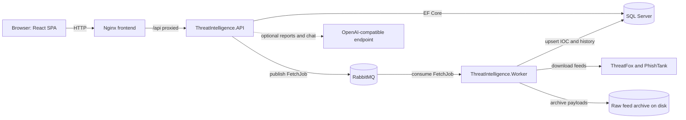

# Threat Aggregation Intelligence Platform

A multi-provider cyber threat intelligence aggregation platform. It ingests indicator-of-compromise
(IOC) feeds from external providers, normalizes and deduplicates them, stores IOC and fetch history
in SQL Server, and exposes a read-only query API plus an authenticated admin console. A React
single-page application is served by Nginx and proxies same-origin `/api/*` calls to the ASP.NET Core
API.

The platform is designed around a small set of IOC types (`Ipv4`, `Ipv6`, `Domain`, `Url`) defined in
`src/ThreatIntelligence.Domain/Enums/IocType.cs`.

## What it is

The platform aggregates IOC data from two external providers that are seeded deterministically on first
startup (`src/ThreatIntelligence.Infrastructure/Persistence/Seeding/ProviderSeeder.cs`):

- **ThreatFox** (`https://threatfox-api.abuse.ch`), ingested from its JSON export files `recent.json`
  and `full.json.zip` (`src/ThreatIntelligence.Infrastructure/ThreatFox/ThreatFoxExportClient.cs`).
  ThreatFox records carry malware family names, threat types, confidence levels, reporter and
  first/last seen timestamps (`src/ThreatIntelligence.Infrastructure/ThreatFox/ThreatFoxRecordMapper.cs`).
- **PhishTank** (`https://data.phishtank.com`), ingested from its `online-valid.json.gz` feed
  (`src/ThreatIntelligence.Infrastructure/PhishTank/PhishTankClient.cs`). PhishTank records are
  verified phishing URLs with target and detail metadata
  (`src/ThreatIntelligence.Infrastructure/PhishTank/PhishTankRecordMapper.cs`).

Fetches are queued by the API, delivered through RabbitMQ, and executed by a Worker process. The
Worker normalizes each provider record, resolves its identity, upserts IOC rows atomically, and records
fetch-history counters. The result is a queryable, provider-attributed IOC corpus with tags and
cross-record relations, presented through the API and the web console.

## Features

### Ingestion and processing

- Multi-provider ingestion from ThreatFox and PhishTank, each with provider-specific parsing, mapping
  and validation pipelines (`src/ThreatIntelligence.Infrastructure/ThreatFox/`,
  `src/ThreatIntelligence.Infrastructure/PhishTank/`).
- Two fetch modes per provider, `recent` and `full`, modeled as a data-driven capability bitmask on the
  provider row (`src/ThreatIntelligence.Domain/Enums/FetchMode.cs`,
  `src/ThreatIntelligence.Domain/Enums/ProviderFetchModes.cs`).
- Scheduled fetches through a periodic worker scheduler that publishes due providers by their configured
  interval, plus manual triggers from the admin API
  (`src/ThreatIntelligence.Infrastructure/Fetches/FetchSchedulerService.cs`,
  `src/ThreatIntelligence.Worker/FetchScheduler.cs`).
- Asynchronous job delivery over RabbitMQ using MassTransit, with a single-job-at-a-time consumer
  (`src/ThreatIntelligence.Infrastructure/Fetches/MassTransitFetchJobPublisher.cs`,
  `src/ThreatIntelligence.Infrastructure/Fetches/FetchJobConsumer.cs`,
  `src/ThreatIntelligence.Worker/Program.cs`).
- A fetch guard and job reservation model that prevents overlapping and duplicate executions, including
  recent/full cooldowns (`src/ThreatIntelligence.Infrastructure/Fetches/FetchGuard.cs`,
  `src/ThreatIntelligence.Application/Fetches/FetchReservation.cs`).
- Original provider payloads are archived to disk per provider and mode before processing
  (`src/ThreatIntelligence.Infrastructure/Storage/RawFeedStore.cs`).
- Normalization of IP addresses (v4 and v6), domains (including IDN handling) and URLs, with parent
  domain resolution backed by a bundled public suffix list
  (`src/ThreatIntelligence.Application/Normalization/`,
  `src/ThreatIntelligence.Infrastructure/PublicSuffix/PublicSuffixParentDomainResolver.cs`).
- IOC classification into `ipv4`, `ipv6`, `domain` and `url`
  (`src/ThreatIntelligence.Application/Normalization/IocClassifier.cs`).
- Atomic, chunked batch upsert with identity resolution and deduplication; a failed batch rolls back all
  IOC and tag writes (`src/ThreatIntelligence.Infrastructure/Pipeline/IocBatchWriter.cs`).
- A computed false-positive state based on a 180-day staleness rule, evaluated at query time and never
  persisted (`src/ThreatIntelligence.Application/BatchWriter/FalsePositiveEvaluator.cs`).

### Query API

- Anonymous, read-only IOC query surface: browse, exact/grouped search, bulk search, per-row detail,
  suggestions, and relations
  (`src/ThreatIntelligence.API/Controllers/IocsController.cs`).
- Relations between indicators: `urlHost` (URLs on a host), `parentDomain` (indicators under a domain),
  and `malware` / `target` (indicators sharing a malware family or target)
  (`src/ThreatIntelligence.API/Controllers/IocsController.cs`,
  `src/ThreatIntelligence.API/Mcp/PublicIocMcpServer.cs`).
- Catalog endpoints for provider names, tags, malware families and targets
  (`src/ThreatIntelligence.API/Controllers/IocsController.cs`).
- A read-only Model Context Protocol (MCP) server exposing IOC tools (`ioc_list_providers`,
  `ioc_search_exact`, `ioc_get_detail`, `ioc_browse`, `ioc_get_relations`) at `/mcp`
  (`src/ThreatIntelligence.API/Mcp/PublicIocMcpServer.cs`, `src/ThreatIntelligence.API/Program.cs`).

### Authentication and administration

- JWT authentication signed with RS256 using a PEM private key file, with an `Admin` role policy and a
  default authenticated-user fallback policy (`src/ThreatIntelligence.API/Program.cs`,
  `src/ThreatIntelligence.API/Controllers/AuthController.cs`).
- Password hashing with bcrypt and a configurable work factor
  (`src/ThreatIntelligence.Infrastructure/Authentication/BcryptPasswordHasher.cs`,
  `src/ThreatIntelligence.Infrastructure/Configuration/ThreatIntelligenceOptions.cs`).
- Admin operations for provider CRUD, manual fetch triggers, fetch-history status, runtime settings and
  summary timelines (`src/ThreatIntelligence.API/Controllers/AdminProviderOperationsController.cs`,
  `src/ThreatIntelligence.API/Controllers/AdminProviderFetchController.cs`,
  `src/ThreatIntelligence.API/Controllers/AdminSettingsController.cs`,
  `src/ThreatIntelligence.API/Controllers/AdminSummaryController.cs`).
- An encrypted provider-credential store using AES-256-GCM with a key version and associated data, so
  provider API keys are written to SQL Server as ciphertext
  (`src/ThreatIntelligence.Infrastructure/Secrets/AesGcmSecretProtector.cs`,
  `src/ThreatIntelligence.API/Controllers/AdminCredentialsController.cs`,
  `src/ThreatIntelligence.Application/Abstractions/Secrets/ManagedSecretNames.cs`).
- Structured logs with correlation IDs and secret redaction, queryable through the admin logs endpoints
  (`src/ThreatIntelligence.API/Program.cs`,
  `src/ThreatIntelligence.Infrastructure/Admin/LogRedactor.cs`,
  `src/ThreatIntelligence.API/Controllers/AdminLogsController.cs`).

### Optional AI analysis

These features are disabled until an operator configures an OpenAI-compatible endpoint in the admin
console. The optional server API key is stored in the encrypted credential store, and IOC chat requires
that credential before it will answer.

- On-demand IOC report generation streamed to the browser over Server-Sent Events, with an optional
  Markdown-to-PDF export rendered by Pandoc and XeLaTeX
  (`src/ThreatIntelligence.API/Controllers/IocAiController.cs`,
  `src/ThreatIntelligence.Application/AI/AiReportGenerator.cs`,
  `src/ThreatIntelligence.Infrastructure/Reporting/MarkdownPdfRenderer.cs`,
  `src/ThreatIntelligence.API/Dockerfile`).
- An IOC chat assistant whose answers are grounded in the same read-only MCP tools the public API
  exposes. The server owns the behavior rules, treats conversation and provider fields as untrusted
  data, and does not persist turns
  (`src/ThreatIntelligence.API/Controllers/IocChatController.cs`,
  `src/ThreatIntelligence.Infrastructure/AI/IocChatService.cs`).
- Versioned AI report instructions managed as a policy through the admin API
  (`src/ThreatIntelligence.API/Controllers/AdminAiReportPolicyController.cs`).

### Frontend

- A static React SPA with file-based routing: IOC browse, search, detail (with relations, AI report and
  chat panels), login, and an admin area for providers, settings, summary and logs
  (`frontend/src/routes/`).
- Nginx serves the built assets, proxies `/api/*` to the API with buffering disabled for streaming, and
  returns SPA history fallback for client routes while returning 404 for missing file-like requests
  (`frontend/nginx.conf`).

### Operations

- Dependency-aware health checks for the API, SQL Server and RabbitMQ, plus a separate liveness probe
  (`src/ThreatIntelligence.API/Program.cs`,
  `src/ThreatIntelligence.Infrastructure/HealthChecks/SqlServerHealthCheck.cs`,
  `src/ThreatIntelligence.Infrastructure/HealthChecks/RabbitMqHealthCheck.cs`).
- OpenAPI document generation and an interactive Scalar API reference in Development and Testing
  environments (`src/ThreatIntelligence.API/Program.cs`).

## Tech stack

Backend and messaging:

- .NET 10 / C# with `Nullable` and `ImplicitUsings` enabled; layered solution of
  Domain, Application, Infrastructure, API and Worker projects
  (`ThreatIntelligence.slnx`, `src/ThreatIntelligence.API/ThreatIntelligence.API.csproj`).
- ASP.NET Core Web API for the HTTP host and the .NET generic host for the Worker
  (`src/ThreatIntelligence.API/Program.cs`, `src/ThreatIntelligence.Worker/Program.cs`).
- Entity Framework Core 10 with the SQL Server provider, plus `Microsoft.Data.SqlClient` for the batch
  writer (`src/ThreatIntelligence.Infrastructure/ThreatIntelligence.Infrastructure.csproj`,
  `src/ThreatIntelligence.Infrastructure/Pipeline/IocBatchWriter.cs`).
- MassTransit 8.5.7 over RabbitMQ for fetch-job messaging
  (`src/ThreatIntelligence.API/ThreatIntelligence.API.csproj`).
- MediatR 12.5.0 for in-process request handling
  (`src/ThreatIntelligence.Application/ThreatIntelligence.Application.csproj`).
- `Microsoft.AspNetCore.Authentication.JwtBearer` 10.0.12 for RS256 JWT validation and
  `BCrypt.Net-Next` 4.0.3 for password hashing
  (`src/ThreatIntelligence.API/ThreatIntelligence.API.csproj`).
- `ModelContextProtocol.AspNetCore` 2.2.0 for the MCP server
  (`src/ThreatIntelligence.API/ThreatIntelligence.API.csproj`).
- Serilog for structured logging, `Microsoft.AspNetCore.OpenApi` and `Scalar.AspNetCore` for API
  documentation, and `Nager.PublicSuffix` 3.8.0 for domain parsing
  (`src/ThreatIntelligence.API/ThreatIntelligence.API.csproj`,
  `src/ThreatIntelligence.Infrastructure/ThreatIntelligence.Infrastructure.csproj`).

Frontend:

- React 19 with Vite 8, TypeScript 6, TanStack Router and TanStack Query
  (`frontend/package.json`).
- Tailwind CSS 4, DataTables, Recharts, Zustand and Zod (`frontend/package.json`).

Infrastructure and tests:

- Docker Compose with SQL Server 2025 Express, RabbitMQ 3.13 (management), the API and Worker images,
  and an Nginx-served frontend (`docker-compose.yml`).
- xUnit for .NET unit and integration tests, Jest for frontend unit tests and Playwright for end-to-end
  tests (`tests/`, `frontend/package.json`).

## Architecture

### Component diagram



### Data flow

1. A fetch is triggered either by an admin action through the API or by the Worker's periodic
   scheduler. The trigger validates the provider and mode, reserves a job for that provider under the
   fetch guard, and publishes a `FetchJob` to RabbitMQ
   (`src/ThreatIntelligence.Infrastructure/Fetches/FetchSchedulerService.cs`,
   `src/ThreatIntelligence.API/Controllers/AdminProviderFetchController.cs`).
2. The Worker consumes the job, downloads the provider feed, archives the raw payload, parses and
   validates each record, and normalizes it
   (`src/ThreatIntelligence.Infrastructure/Fetches/FetchJobConsumer.cs`,
   `src/ThreatIntelligence.Infrastructure/Storage/RawFeedStore.cs`,
   `src/ThreatIntelligence.Application/Normalization/`).
3. The batch writer resolves identities and upserts IOC rows, tag associations and fetch-history
   counters into SQL Server inside one transaction
   (`src/ThreatIntelligence.Infrastructure/Pipeline/IocBatchWriter.cs`).
4. The frontend and API clients read the aggregated data through the anonymous IOC endpoints, and
   administrators manage providers and settings through the authenticated admin endpoints. The
   supported processing flow is also documented in `USAGE.md`.

### Repository layout

- `src/ThreatIntelligence.Domain`: entities, enums and domain rules.
- `src/ThreatIntelligence.Application`: use cases, normalization, validation, batch-writer and AI
  contracts.
- `src/ThreatIntelligence.Infrastructure`: persistence, provider clients, messaging, secrets, storage,
  health checks and AI adapters.
- `src/ThreatIntelligence.API` and `src/ThreatIntelligence.Worker`: HTTP host and background host.
- `frontend/`: React, Vite and TanStack Router SPA with its Dockerfile and Nginx configuration.
- `tests/`: .NET unit and integration tests. `openspec/` holds the specification and design documents.

## Getting started

### Prerequisites

- Docker Engine or Docker Desktop with Docker Compose v2 (the startup flow uses `docker compose up
  --wait`).
- A Bash-compatible terminal with `openssl` and `curl`.
- For local development outside Docker only: .NET SDK 10, Node.js 24 and npm.

### Configuration

Copy the template and fill in every placeholder. Never commit the resulting file
(`.env.example`, `.gitignore`).

```bash
cp .env.example .env
chmod 600 .env
```

The relevant configuration keys, with placeholder values (`docker-compose.yml`, `.env.example`):

- `SA_PASSWORD=<strong-sql-password>`: SQL Server bootstrap password used by the Compose database.
- `DATABASE__CONNECTIONSTRING=<local-sql-connection-string>`: connection string for running the API
  outside Compose. Compose overrides it to point at the `mssql` service; keep the password aligned with
  `SA_PASSWORD`.
- `RABBITMQ__HOST`, `RABBITMQ__PORT`, `RABBITMQ__USER`, `RABBITMQ__PASSWORD`, `RABBITMQ__EXCHANGE`:
  broker connection and exchange name.
- `ENCRYPTION__ROOTKEYFILE`, `ENCRYPTION__KEYVERSION`: Base64 root key file for the AES-256-GCM
  credential store and its starting key version.
- `JWT__PRIVATEKEYFILE`, `JWT__ISSUER`, `JWT__AUDIENCE`, `JWT__EXPIRYMINUTES`: RS256 signing key file
  and token settings. `JWT__EXPIRYMINUTES` must be `480`
  (`src/ThreatIntelligence.Infrastructure/Configuration/ThreatIntelligenceOptions.cs`).
- `ADMIN__USERNAME`, `ADMIN__PASSWORD`: initial administrator account created on first startup.
- `RAWSTORAGE__BASEPATH`: directory for archived raw provider payloads.
- `LOGGING__MINIMUMLEVEL` and `FRONTEND_PORT`: minimum log level and the host port for the Nginx
  frontend (default `3000`).

Generate the two required secret files once (`.env.example`, `docker-compose.yml`):

```bash
umask 077
mkdir -p secrets
(set -o noclobber; openssl rand -base64 32 > secrets/encryption-root-key)
(set -o noclobber; openssl genpkey -algorithm RSA -pkeyopt rsa_keygen_bits:3072 > secrets/jwt-private-key.pem)
chmod 700 secrets
chmod 600 secrets/*
```

The encryption root key must decode to exactly 32 bytes, and the JWT key must be a passwordless RSA PEM
file. `docker-compose.yml` mounts both into the `api` and `worker` containers as read-only Docker
secrets and sets `ENCRYPTION__ROOTKEYFILE` and `JWT__PRIVATEKEYFILE` to the in-container
`/run/secrets/...` paths.

Provider API keys are normally written to the encrypted credential store rather than the deployment
`.env`: after logging in, store them through the admin credentials endpoint or console, and they are
encrypted before being written to SQL Server
(`src/ThreatIntelligence.API/Controllers/AdminCredentialsController.cs`, `.env.example`).

### Run the full stack with Docker Compose

```bash
docker compose config --quiet
docker compose build
docker compose up -d --wait --wait-timeout 300
docker compose ps
```

On first start the API applies EF Core migrations and seeds the initial administrator and the two
providers (`src/ThreatIntelligence.Infrastructure/Persistence/DatabaseInitializer.cs`,
`src/ThreatIntelligence.Infrastructure/Persistence/Seeding/AdminSeeder.cs`). Compose exposes
(`docker-compose.yml`):

- Web console: `http://localhost:3000` (sign in with `ADMIN__USERNAME` and `ADMIN__PASSWORD`).
- API: `http://localhost:8080`; `GET /health` reports dependency health and `GET /health/live` is a
  liveness probe.
- RabbitMQ management: `http://localhost:15672`.
- Worker: no UI; port `8081` exists only for its health check.
- SQL Server: port `1433` (`1432` for the isolated test database under the `test` Compose profile).

To run the API and Worker locally against containerized dependencies, or to run the frontend with Vite
HMR, follow the development options in `docker-compose.yml` and `USAGE.md`.

### Tests

```bash
dotnet test tests/ThreatIntelligence.UnitTests
docker compose --profile test up -d --wait testsqlserver
dotnet test tests/ThreatIntelligence.IntegrationTests
cd frontend
npm ci
npm test
npm run test:e2e
```

Integration tests create and drop their own databases; do not point them at a production database
(`tests/ThreatIntelligence.IntegrationTests/SqlServerFixture.cs`).

## Usage example

The IOC query endpoints are read-only and anonymous; admin endpoints require a token
(`src/ThreatIntelligence.API/Controllers/IocsController.cs`,
`src/ThreatIntelligence.API/Controllers/AuthController.cs`).

Log in to obtain a JWT:

```bash
curl -s -X POST http://localhost:8080/api/auth/login \
  -H 'Content-Type: application/json' \
  -d '{"username":"admin","password":"<admin-password>"}'
```

Search aggregated IOC groups by value, tag or provider:

```bash
curl -s 'http://localhost:8080/api/iocs/search?q=evil.example&tag=phishing&page=1&pageSize=20'
```

Browse with filters and pagination (supported `type` values are `ipv4`, `ipv6`, `domain` and `url`):

```bash
curl -s 'http://localhost:8080/api/iocs?type=url&provider=ThreatFox&firstSeenFrom=2026-01-01&page=1&pageSize=20'
```

Fetch one IOC group's relations:

```bash
curl -s 'http://localhost:8080/api/iocs/42/relations?relation=urlHost&page=1&pageSize=20'
```

Trigger a manual provider fetch as an administrator (returns `202 Accepted` with a `jobId`):

```bash
curl -s -X POST http://localhost:8080/api/admin/providers/1/fetch \
  -H "Authorization: Bearer <jwt>"
```

The full endpoint and filter reference, including request/response shapes and error statuses, is in
`USAGE.md`.

## Status and license

This repository is private and there is no public deployment, demo or hosted instance; the only way to
run the platform is the local Docker Compose flow described above. No `LICENSE` file is present in the
repository, so no license is granted and all rights are reserved by the author unless a license is added
later.

Implemented and covered by tests, as described in this README: provider ingestion and scheduling,
normalization and classification, atomic deduplicated persistence, the anonymous query API and
relations, JWT authentication, the admin console and operations, the encrypted credential store, the
MCP server, and health and structured logging.

Optional and operator-dependent: AI report generation, PDF export and IOC chat require a configured
OpenAI-compatible endpoint (with a stored server credential for IOC chat) and remain disabled until
then (`src/ThreatIntelligence.API/Controllers/AdminAiSettingsController.cs`,
`src/ThreatIntelligence.Application/AI/AiReportGenerator.cs`).

For architecture and requirements detail beyond this README, see `USAGE.md` and `openspec/`.
Frontend-specific detail is in `frontend/README.md`.
